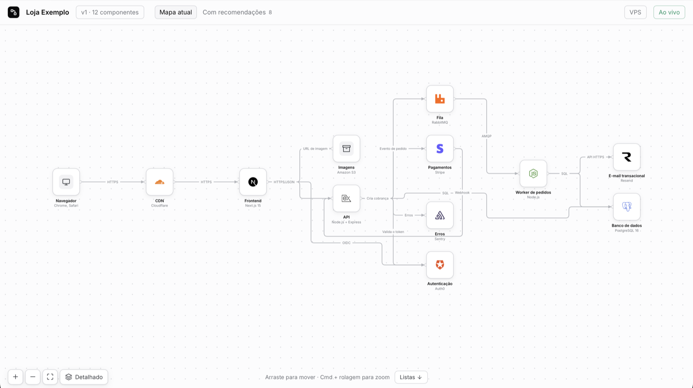
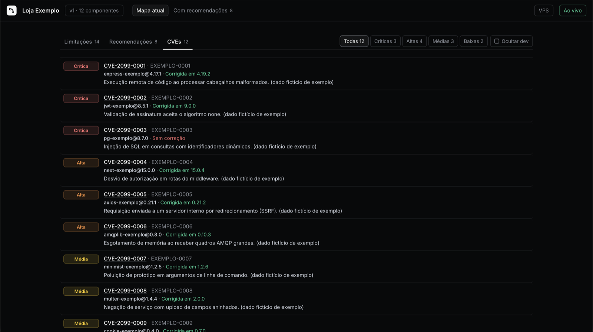
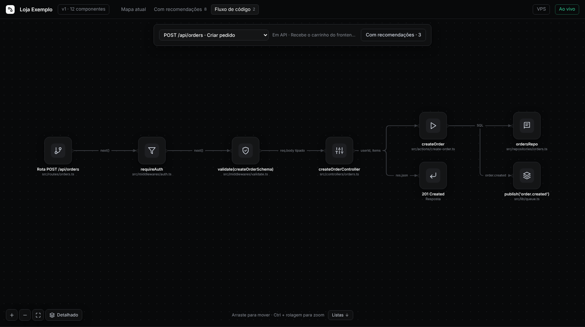
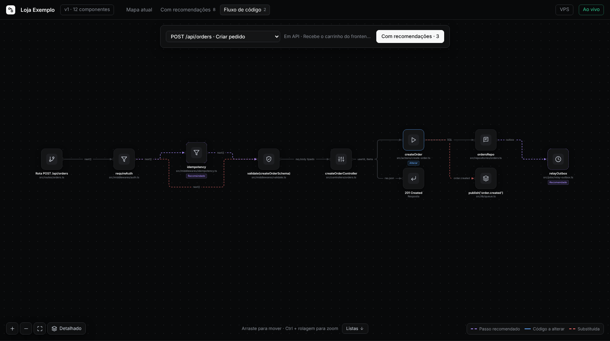

<div align="center">


# system-design-skill

**Your project's architecture map, live and reviewable, for you and your AI.**


[](LICENSE)

[Screenshots](#screenshots) • [Install](#install) • [Updating](#updating) • [Usage](#usage) • [What init changes](#what-init-changes-in-your-project) • [Confidentiality](#confidentiality) • [What leaves your machine](#what-leaves-your-machine)

English • <a href="README.pt-BR.md">Português</a>

</div>

system-design is a skill for AI agents. It keeps the project's architecture in `.system-design/` (components, connections, capacity limits, recommendations and dependency vulnerabilities) and shows everything on a local n8n-style page.

It also maps **code flows**: for each important route (for example `POST /api/orders`), the path the request takes through the code (route, middlewares, validation, controller, action, repository, response), with each file's code and a summary of what it does. A **With recommendations** toggle shows suggested new steps and suggested code changes.

The AI reads a summary of the map before touching the backend. When a task changes the flow (a new database, queue, external API or deploy), it proposes the change, you approve it on the page, and only then does it implement it, reporting progress in real time.

## Screenshots

The map shows components and connections. The button in the bottom-left corner switches between simplified mode (icons by type) and detailed mode (logos and technologies). The light and dark themes follow the system.

<p align="center">
  
  
</p>

The **Com recomendações** (With recommendations) button, at the bottom right of the **Infraestrutura** tab, draws the suggested architecture over the current one: what comes in is dashed purple and what goes out is dashed red.

<p align="center">
  
</p>

<p align="center">
  
  
</p>

Below the map are the lists of limits and dependency vulnerabilities. Clicking a limit highlights the affected component on the map.

<p align="center">
  
</p>

<p align="center">
  
</p>

The **Fluxo de código** (Code flow) tab draws one route at a time. Pick the route at the top; each step is a node with its file. Clicking a step opens its summary, the file and lines, and the code with syntax highlighting. Without inline code, `sd.py` reads the snippet from the file on disk, so the page follows the code.

<p align="center">
  
</p>

<p align="center">
  
</p>

The flow's **CVEs** list shows only the vulnerabilities of the packages its files import, directly or through their dependencies, and flags the affected step on the map.

The **Com recomendações** (With recommendations) toggle adds suggested steps (dashed purple, such as an idempotency middleware), marks steps whose code should change (blue, with *Atual* and *Sugerido* views) and the connections that go away (dashed red). Each recommendation has a button that copies a ready request, with the suggested code, to paste into the agent.

<p align="center">
  
  
</p>

> [!NOTE]
> The screenshot data comes from [`examples/`](examples) and is fictional. The page itself is in Portuguese for now.

> [!NOTE]
> Independent project. The skill uses only the Python 3 standard library.

## Install

```bash
npx skills add CarlosAllberto/system-design-skill
```

The command installs the skill in the compatible agents you use. The repository is called `system-design-skill`, but the installed skill is called `system-design`, the name set in `SKILL.md`. Requirement: Python 3 (on Windows the command may be `python`).

## Updating

**Update the skill.** Run `npx skills add CarlosAllberto/system-design-skill` again. It fetches the latest version from GitHub.

**Bring the new version into a project you already mapped.** Ask the agent "update the system design of this project", or run:

```bash
python3 <skill path>/scripts/sd.py init
python3 .system-design/sd.py build
```

`init` only re-copies `sd.py` and the page. The map, flows, history and CVEs are kept. `build` warns when the project copy is older than the installed skill, and `python3 .system-design/sd.py version` shows the version.

**Re-read the project after the code changed outside the agent.** Ask the agent to resync the map (mode 5). To do it by hand, `python3 .system-design/sd.py check` lists what drifted from the code and `check --fix` fixes the line ranges of the flow steps. Infrastructure changes still go through the approval proposal. After dependency changes, run `sd.py cves` again.

## Usage

Ask the agent something like "map the system design of this project". The skill has 5 modes:

| Mode | When | What happens |
| --- | --- | --- |
| 1. Map an existing project | The project already has code | The AI reads the code, asks all its questions in one round and writes `map.json` with nodes, connections, limits, recommendations and the code flows of the main routes |
| 2. Design a new backend | New app, no backend yet | The target architecture and the planned code flows (with starter code) become a proposal with implementation tasks |
| 3. Propose before changing the flow | New component, database, queue, cache, external API, authentication or deploy | The AI registers the proposal and waits for you to approve it in the update tab |
| 4. Run the approved update | After approval | Each item goes through `waiting`, `in_progress` and `done`; at the end `finalize` updates the map |
| 5. Resync with the code | The code changed outside the agent, or after a skill update | The AI starts from the current map, runs `check`, fixes flow line ranges, proposes infrastructure changes for approval and refreshes the CVEs if dependencies changed |

To map only the code of one route, ask something like "map the code flow of api/users" or "show the code flow of POST /api/orders with recommendations".

Useful commands, from the project root:

```bash
python3 .system-design/sd.py serve --open
python3 .system-design/sd.py cves
python3 .system-design/sd.py build
python3 .system-design/sd.py check
python3 .system-design/sd.py version
```

An example to try is in [`examples/map.example.json`](examples/map.example.json). To see the vulnerabilities tab, also copy [`examples/cves.example.json`](examples/cves.example.json) to `.system-design/cves.json` (the data is fictional) and run `build`.

## What init changes in your project

`sd.py init` creates the `.system-design/` folder and touches only this:

- **`AGENTS.md`:** adds a block between `<!-- system-design:start -->` and `<!-- system-design:end -->` with one conditional line ("if `.system-design/AI-MAP.md` exists, read it"). The rest of the file is not touched, and running `init` again duplicates nothing.
- **`CLAUDE.md`:** only removes the system-design block, if there is one. If the file does not import `AGENTS.md`, `init` warns you.
- **`.gitignore`:** adds `.system-design/`.

## Confidentiality

The `.system-design/` folder describes the project's architecture, limits and vulnerabilities. If it leaks, it becomes an attack roadmap.

- Do not commit it or paste its content into an issue, PR, public chat or external service. The generated `index.html` also embeds the code of the flow steps.
- `init` adds the folder to `.gitignore` and warns you if git already tracks any file in it.
- For backups, keep the folder somewhere private.

## What leaves your machine

Only this:

1. `sd.py cves` sends package names and versions to [OSV](https://osv.dev).
2. The page asks [Simple Icons](https://simpleicons.org) for logos by brand slug. To turn this off, set `"logos": false` in `project` in `map.json`.
3. The page asks Google Fonts for the Inter font.

No content from `map.json` (project names, limits, descriptions) is sent to third parties.

## Structure

```
system-design-skill/
├── SKILL.md          Instructions for the agent
├── scripts/sd.py     Lifecycle CLI (propose, approve, set, finalize, cves, check, serve)
├── assets/viewer.html Map page
├── docs/screenshots/ README screenshots
├── references/       map.json schema, code flows, limits, recommendations, new app
└── examples/         Example map
```

## License

[MIT](LICENSE)
