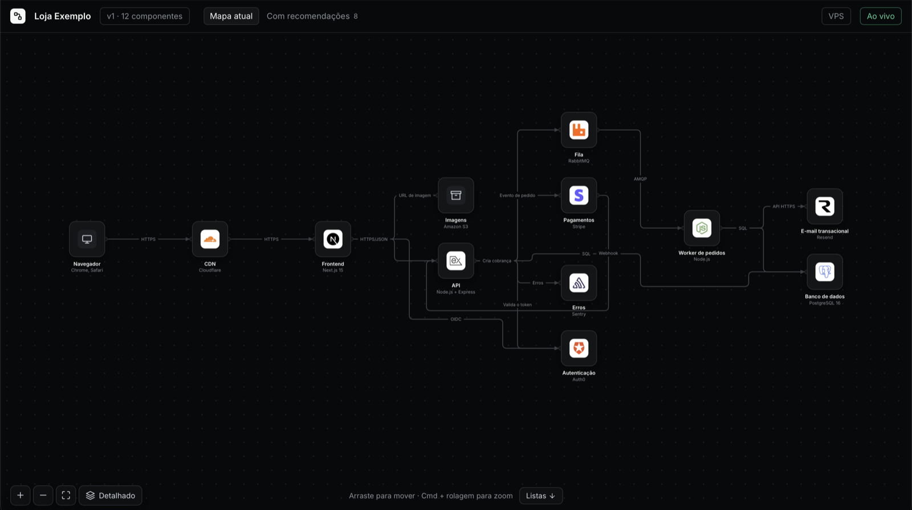
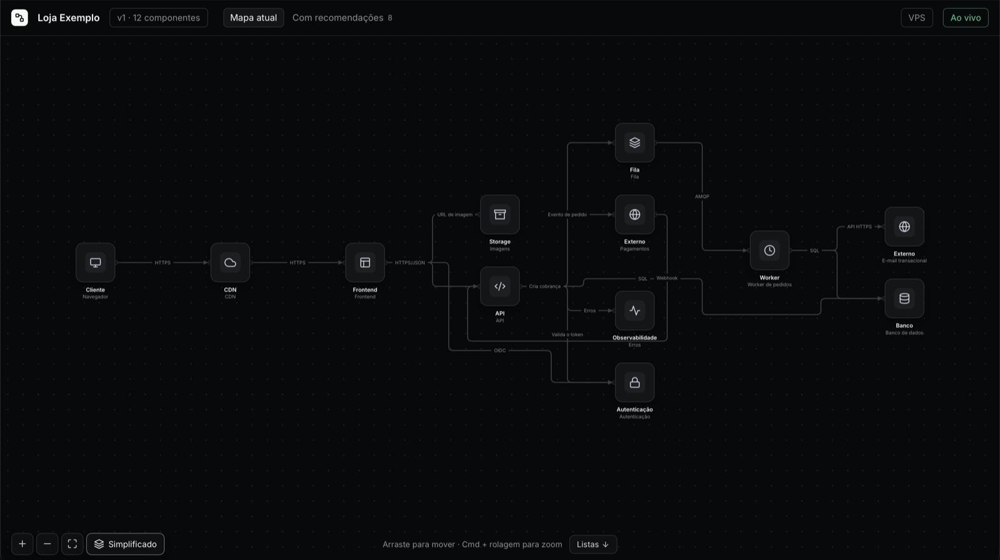
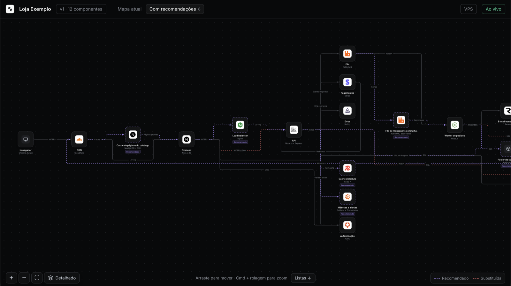
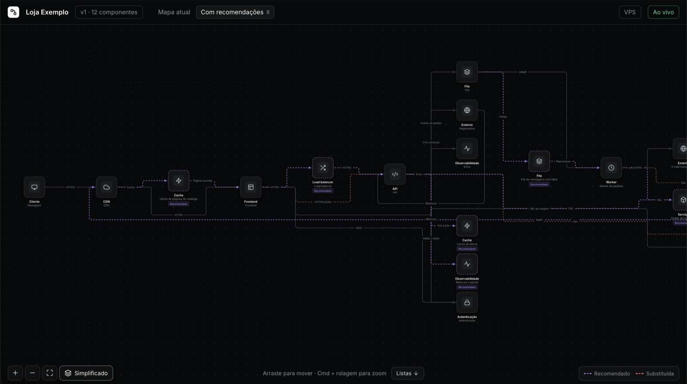
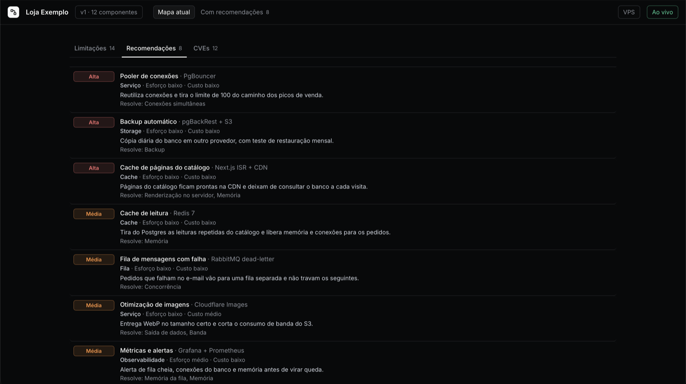
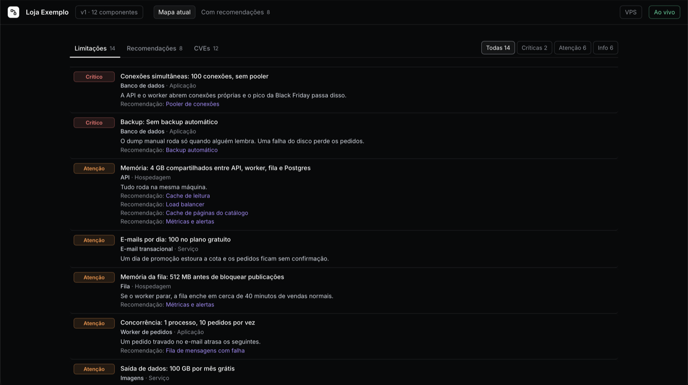
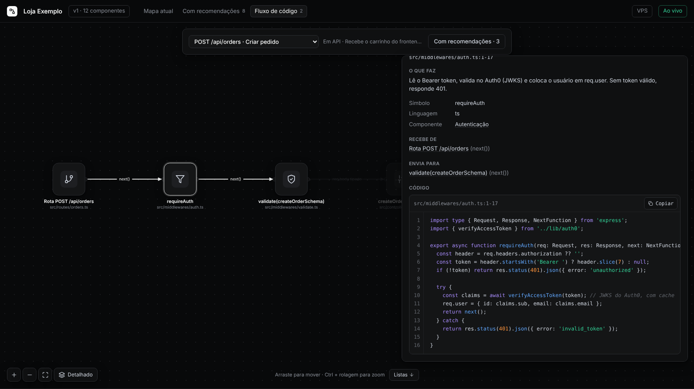
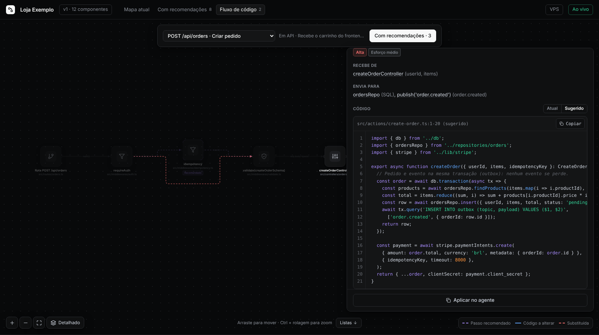

<div align="center">



# system-design-skill

**Your project's architecture map, live and reviewable, for you and your AI.**


[](LICENSE)

[Screenshots](#screenshots) • [Install](#install) • [Updating](#updating) • [Usage](#usage) • [What init changes](#what-init-changes-in-your-project) • [Confidentiality](#confidentiality) • [What leaves your machine](#what-leaves-your-machine)

English • <a href="README.pt-BR.md">Português</a>

</div>

system-design is a skill for AI agents. It keeps the project's architecture in `.system-design/` (components, connections, capacity limits, recommendations and dependency vulnerabilities) and shows everything on a local n8n-style page.

It also maps **code flows**: for each important route (for example `POST /api/orders`), the path the request takes through the code (route, middlewares, validation, controller, action, repository, response), with each file's code and a summary of what it does. A **With recommendations** toggle shows suggested new steps and suggested code changes.

The AI reads a summary of the map before touching the backend. When a task changes the flow (a new database, queue, external API or deploy), it proposes the change, you approve it on the page, and only then does it implement it, reporting progress in real time.

## Screenshots

The map shows components and connections. The button in the bottom-left corner switches between simplified mode (icons by type) and detailed mode (logos and technologies). The light and dark themes follow the system.

<p align="center">
  
  
</p>

The **Com recomendações** (With recommendations) button, at the bottom right of the **Infraestrutura** tab, draws the suggested architecture over the current one: what comes in is dashed purple and what goes out is dashed red.

<p align="center">
  
</p>

<p align="center">
  
  
</p>

Below the map are the lists of limits and dependency vulnerabilities. Clicking a limit highlights the affected component on the map.

<p align="center">
  
</p>

<p align="center">
  
</p>

The **Fluxo de código** (Code flow) tab draws one route at a time. Pick the route at the top; each step is a node with its file. Clicking a step opens its summary, the file and lines, and the code with syntax highlighting. Without inline code, `sd.py` reads the snippet from the file on disk, so the page follows the code.

<p align="center">
  
</p>

<p align="center">
  
</p>

The flow's **CVEs** list shows only the vulnerabilities of the packages its files import, directly or through their dependencies, and flags the affected step on the map.

The **Com recomendações** (With recommendations) toggle adds suggested steps (dashed purple, such as an idempotency middleware), marks steps whose code should change (blue, with *Atual* and *Sugerido* views) and the connections that go away (dashed red). Each recommendation has a button that copies a ready request, with the suggested code, to paste into the agent.

<p align="center">
  
  
</p>

> [!NOTE]
> The screenshot data comes from [`examples/`](examples) and is fictional. The page itself is in Portuguese for now.

> [!NOTE]
> Independent project. The skill uses only the Python 3 standard library.

## Install

```bash
npx skills add CarlosAllberto/system-design-skill
```

The command installs the skill in the compatible agents you use. The repository is called `system-design-skill`, but the installed skill is called `system-design`, the name set in `SKILL.md`. Requirement: Python 3 (on Windows the command may be `python`).

## Updating

**Update the skill.** Run `npx skills add CarlosAllberto/system-design-skill` again. It fetches the latest version from GitHub.

**Bring the new version into a project you already mapped, or re-read the project after the code changed outside the agent.** Run `/system-design update`. The agent re-copies `sd.py` and the page (the map, flows, history and CVEs are kept), checks what drifted from the code, fixes the flow line ranges, proposes infrastructure changes for approval and refreshes the CVEs if dependencies changed. `/system-design version` shows the project's version.

## Usage

Call the skill with a command. The agent runs the scripts behind the scenes, so you never type `python3`:

```text
/system-design init                         map the project (or design the backend, if it has none yet)
/system-design run                          open the map page in the browser
/system-design update                       resync the map with the code and the skill version
/system-design status                       version, pending update and drift from the code
/system-design flow POST /api/orders        map the code flow of a route
/system-design propose add Redis            propose an infrastructure change for you to approve
/system-design approve                      approve the proposal (the page button does the same)
/system-design apply                        implement the approved update
/system-design help                         list every command
```

| Command | What it does |
| --- | --- |
| `init` | Maps the project: reads the code, asks all its questions in one round and writes the map with nodes, connections, limits, recommendations, CVEs and the flows of the main routes. In a project with no backend, it designs the target architecture as a proposal. If the project is already mapped, it runs `update` |
| `new [idea]` | Designs the backend of a new app from the idea |
| `run` | Builds and opens the live page (`http://localhost:4747`) |
| `update` | Resyncs the map with the code and brings the new skill version into the project |
| `status` | Shows the version, the state of the pending update and drift from the code |
| `flow <route>` | Maps or updates the code flow of a route. Add "with recommendations" to get code suggestions |
| `propose <change>` | Registers an infrastructure change (database, queue, cache, external API, deploy) and waits for your approval in the update tab |
| `approve` / `reject [reason]` / `discard` | Approves, rejects or discards the proposal |
| `apply` | Implements the approved update, reporting each item's progress on the page |
| `check [--fix]` | Checks whether the map matches the code; `--fix` fixes the flow line ranges |
| `cves` | Scans the dependencies for known vulnerabilities |
| `build` | Regenerates the page and the AI summary |
| `version` | Shows the skill version in the project |
| `help` | Lists the commands |

Commands also accept Portuguese aliases (`mapear`, `abrir`, `atualizar`, `fluxo`, `propor`, `aprovar`, `implementar`, `ajuda`). With no command, `/system-design` shows the `status`. Natural-language requests still work, such as "map the system design of this project" or "show the code flow of POST /api/orders with recommendations".

Behind the commands, the skill follows 5 modes:

| Mode | Command | What happens |
| --- | --- | --- |
| 1. Map an existing project | `init` | The AI reads the code, asks all its questions in one round and writes `map.json` |
| 2. Design a new backend | `init` or `new` | The target architecture and the planned code flows (with starter code) become a proposal with implementation tasks |
| 3. Propose before changing the flow | `propose` | The AI registers the proposal and waits for you to approve it in the update tab. It also does this on its own before any task that changes the infrastructure |
| 4. Run the approved update | `apply` | Each item goes through `waiting`, `in_progress` and `done`; at the end the map is updated |
| 5. Resync with the code | `update` | The AI starts from the current map, fixes flow line ranges, proposes infrastructure changes for approval and refreshes the CVEs if dependencies changed |

The commands work in agents with skill slash commands, such as Claude Code. In another agent, ask in text ("system-design run") or run the CLI directly: `python3 .system-design/sd.py <command>` (see `sd.py --help`).

An example to try is in [`examples/map.example.json`](examples/map.example.json). To see the vulnerabilities tab, also copy [`examples/cves.example.json`](examples/cves.example.json) to `.system-design/cves.json` (the data is fictional) and run `build`.

## What init changes in your project

`sd.py init` creates the `.system-design/` folder and touches only this:

- **`AGENTS.md`:** adds a block between `<!-- system-design:start -->` and `<!-- system-design:end -->` with one conditional line ("if `.system-design/AI-MAP.md` exists, read it"). The rest of the file is not touched, and running `init` again duplicates nothing.
- **`CLAUDE.md`:** only removes the system-design block, if there is one. If the file does not import `AGENTS.md`, `init` warns you.
- **`.gitignore`:** adds `.system-design/`.

## Confidentiality

The `.system-design/` folder describes the project's architecture, limits and vulnerabilities. If it leaks, it becomes an attack roadmap.

- Do not commit it or paste its content into an issue, PR, public chat or external service. The generated `index.html` also embeds the code of the flow steps.
- `init` adds the folder to `.gitignore` and warns you if git already tracks any file in it.
- For backups, keep the folder somewhere private.

## What leaves your machine

Only this:

1. `sd.py cves` sends package names and versions to [OSV](https://osv.dev).
2. The page asks [Simple Icons](https://simpleicons.org) for logos by brand slug. To turn this off, set `"logos": false` in `project` in `map.json`.
3. The page asks Google Fonts for the Inter font.

No content from `map.json` (project names, limits, descriptions) is sent to third parties.

## Structure

```
system-design-skill/
├── SKILL.md          Instructions for the agent
├── scripts/sd.py     Lifecycle CLI (propose, approve, set, finalize, cves, check, serve)
├── assets/viewer.html Map page
├── docs/screenshots/ README screenshots
├── references/       map.json schema, code flows, limits, recommendations, new app
└── examples/         Example map
```

## License

[MIT](LICENSE)
