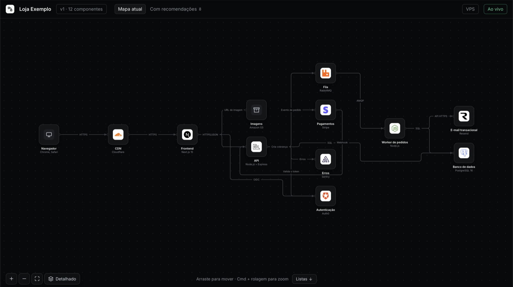
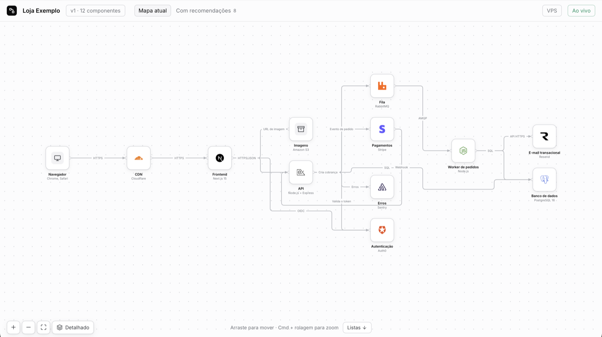
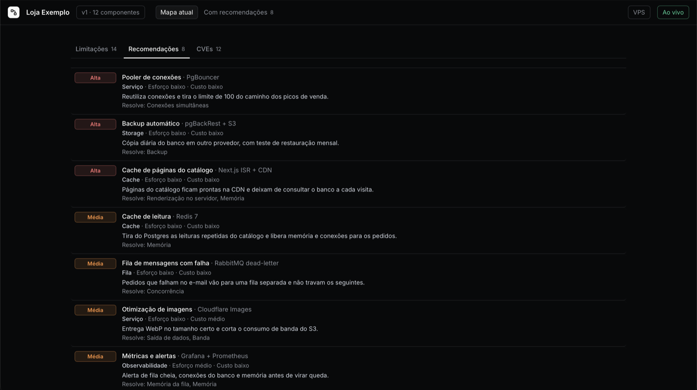
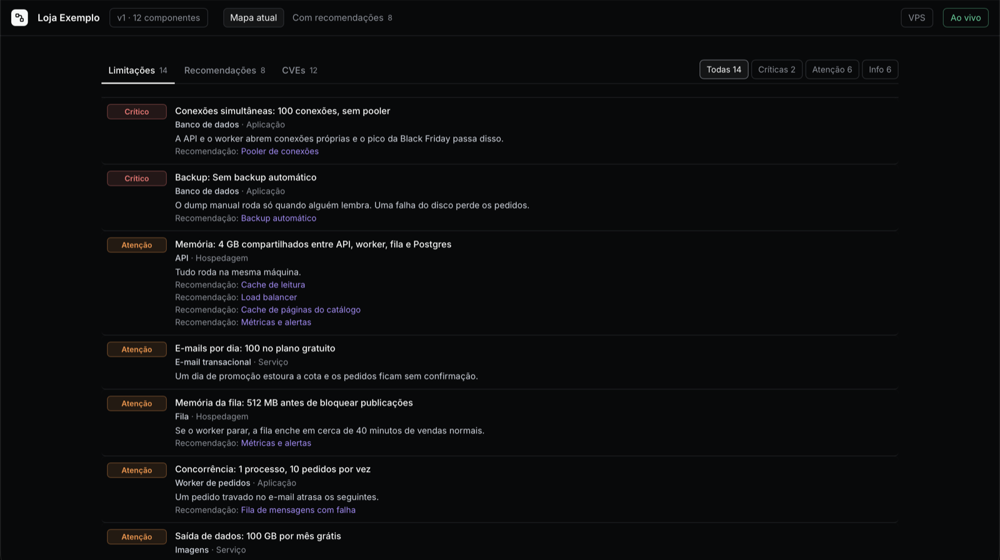
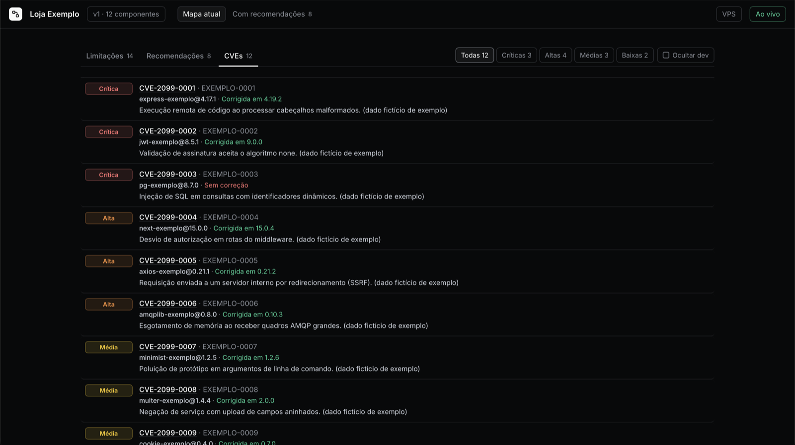

<div align="center">



# system-design-skill

**O mapa de arquitetura do seu projeto, vivo e revisável, para você e para a sua IA.**


[](LICENSE)

[Capturas](#capturas) • [Instalação](#instalação) • [Uso](#uso) • [O que o init altera](#o-que-o-init-altera-no-projeto) • [Confidencialidade](#confidencialidade) • [O que sai da sua máquina](#o-que-sai-da-sua-máquina)

<a href="README.md">English</a> • Português

</div>

O system-design é uma skill para agentes de IA. Ela guarda a arquitetura do projeto em `.system-design/` (componentes, conexões, limites de capacidade, recomendações e vulnerabilidades das dependências) e mostra tudo numa página local no estilo n8n.

A IA lê um resumo do mapa antes de mexer em backend. Quando uma tarefa muda o fluxo (novo banco, fila, API externa, deploy), ela propõe a mudança, você aprova na página e só então ela implementa, marcando o progresso em tempo real.

## Capturas

O mapa mostra os componentes e as conexões. O botão do canto inferior alterna entre o modo simplificado (ícones por tipo) e o detalhado (logos e tecnologias). O tema claro e o escuro seguem o sistema.

<p align="center">
  
  
</p>

A aba **Com recomendações** desenha a arquitetura sugerida sobre a atual: o que entra fica tracejado em roxo e o que sai, em vermelho.

<p align="center">
  
</p>

<p align="center">
  
  
</p>

Abaixo do mapa ficam as listas de limitações e de vulnerabilidades das dependências. Clicar numa limitação destaca o componente afetado no mapa.

<p align="center">
  
</p>

<p align="center">
  
</p>

> [!NOTE]
> Os dados das capturas vêm de [`examples/`](examples) e são fictícios.

> [!NOTE]
> Projeto independente. A skill usa só a biblioteca padrão do Python 3.

## Instalação

```bash
npx skills add CarlosAllberto/system-design-skill
```

O comando instala a skill nos agentes compatíveis que você usa. O repositório se chama `system-design-skill`, mas a skill instalada se chama `system-design`, nome definido no `SKILL.md`. Requisito: Python 3 (no Windows o comando pode ser `python`).

## Uso

Peça ao agente algo como "mapeie o system design deste projeto". A skill tem 4 modos:

| Modo | Quando | O que acontece |
| --- | --- | --- |
| 1. Mapear um projeto existente | O projeto já tem código | A IA lê o código, faz todas as perguntas numa rodada só e escreve o `map.json` com nós, conexões, limites e recomendações |
| 2. Desenhar um backend novo | App novo, sem backend | A arquitetura alvo vira uma proposta com tarefas de implementação |
| 3. Propor antes de mudar o fluxo | Novo componente, banco, fila, cache, API externa, autenticação ou deploy | A IA registra a proposta e espera você aprovar na aba Atualização |
| 4. Executar a atualização aprovada | Depois da aprovação | Cada item passa por `waiting`, `in_progress` e `done`; no fim o `finalize` atualiza o mapa |

Comandos úteis, a partir da raiz do projeto:

```bash
python3 .system-design/sd.py serve --open
python3 .system-design/sd.py cves
python3 .system-design/sd.py build
```

Um exemplo para testar fica em [`examples/map.example.json`](examples/map.example.json). Para ver a aba de vulnerabilidades, copie também [`examples/cves.example.json`](examples/cves.example.json) para `.system-design/cves.json` (os dados são fictícios) e rode `build`.

## O que o init altera no projeto

O `sd.py init` cria a pasta `.system-design/` e mexe só nisto:

- **`AGENTS.md`:** acrescenta um bloco entre `<!-- system-design:start -->` e `<!-- system-design:end -->` com uma linha condicional ("se existir `.system-design/AI-MAP.md`, leia"). O resto do arquivo não é tocado, e rodar o `init` de novo não duplica nada.
- **`CLAUDE.md`:** só remove o bloco do system-design, se existir. Se o arquivo não importar o `AGENTS.md`, o `init` avisa.
- **`.gitignore`:** adiciona `.system-design/`.

## Confidencialidade

A pasta `.system-design/` descreve a arquitetura, os limites e as vulnerabilidades do projeto. Se vazar, vira um roteiro de ataque.

- Não faça commit dela nem cole o conteúdo em issue, PR, chat público ou serviço externo.
- O `init` põe a pasta no `.gitignore` e avisa se o git já rastreia algum arquivo dela.
- Para backup, guarde a pasta num lugar privado.

## O que sai da sua máquina

Só isto:

1. `sd.py cves` envia nomes e versões de pacotes ao [OSV](https://osv.dev).
2. A página pede ao [Simple Icons](https://simpleicons.org) os logos pelo slug da marca. Para desligar, ponha `"logos": false` em `project` no `map.json`.
3. A página pede a fonte Inter ao Google Fonts.

Nenhum conteúdo do `map.json` (nomes de projeto, limites, descrições) é enviado a terceiros.

## Estrutura

```
system-design-skill/
├── SKILL.md          Instruções para o agente
├── scripts/sd.py     CLI do ciclo de vida (propose, approve, set, finalize, cves, serve)
├── assets/viewer.html Página do mapa
├── docs/screenshots/ Capturas do README
├── references/       Esquema do map.json, limites, recomendações, app novo
└── examples/         Mapa de exemplo
```

## Licença

[MIT](LICENSE)
