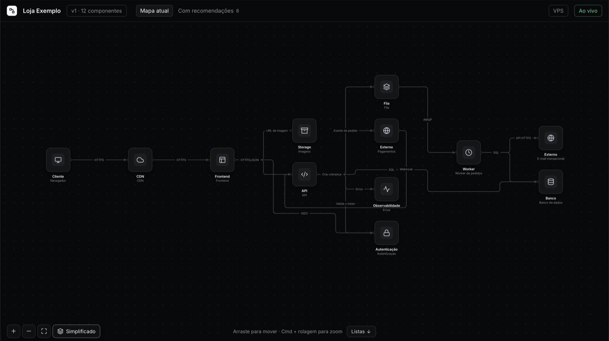
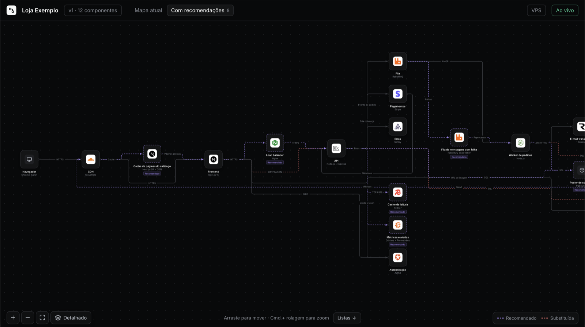
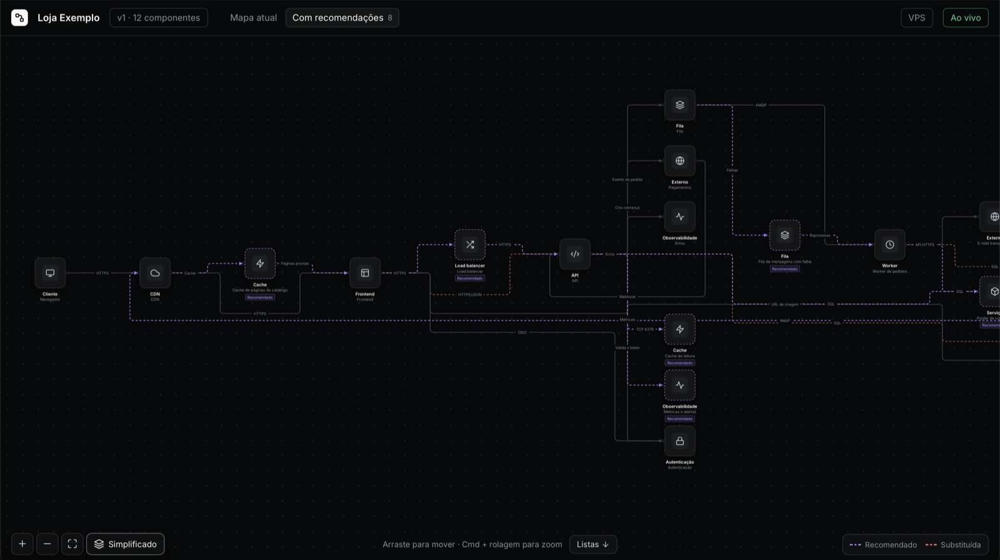
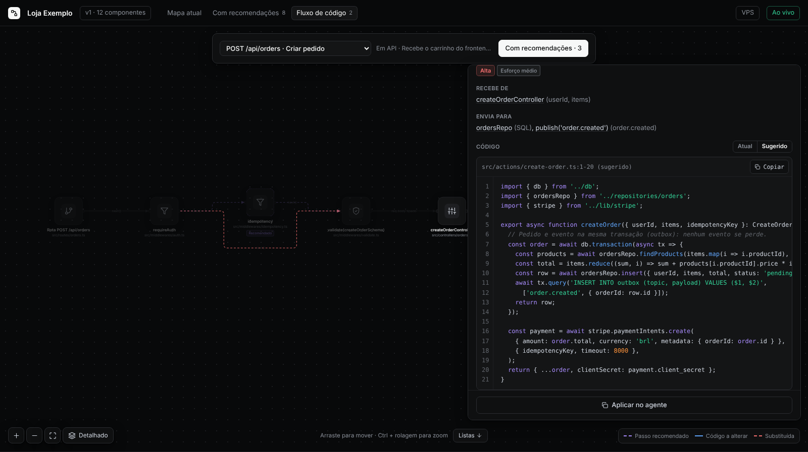

<div align="center">


# system-design-skill

**O mapa de arquitetura do seu projeto, vivo e revisável, para você e para a sua IA.**


[](LICENSE)

[Capturas](#capturas) • [Instalação](#instalação) • [Atualização](#atualização) • [Uso](#uso) • [O que o init altera](#o-que-o-init-altera-no-projeto) • [Confidencialidade](#confidencialidade) • [O que sai da sua máquina](#o-que-sai-da-sua-máquina)

<a href="README.md">English</a> • Português

</div>

O system-design é uma skill para agentes de IA. Ela guarda a arquitetura do projeto em `.system-design/` (componentes, conexões, limites de capacidade, recomendações e vulnerabilidades das dependências) e mostra tudo numa página local no estilo n8n.

Ela também mapeia **fluxos de código**: para cada rota importante (por exemplo `POST /api/orders`), o caminho que a requisição faz no código (rota, middlewares, validação, controller, action, repositório, resposta), com o código de cada arquivo e um resumo do que ele faz. O botão **Com recomendações** mostra os passos novos sugeridos e as mudanças de código sugeridas.

A IA lê um resumo do mapa antes de mexer em backend. Quando uma tarefa muda o fluxo (novo banco, fila, API externa, deploy), ela propõe a mudança, você aprova na página e só então ela implementa, marcando o progresso em tempo real.

## Capturas

O mapa mostra os componentes e as conexões. O botão do canto inferior alterna entre o modo simplificado (ícones por tipo) e o detalhado (logos e tecnologias). O tema claro e o escuro seguem o sistema.

<p align="center">
  
  
</p>

O botão **Com recomendações**, no canto inferior direito da aba **Infraestrutura**, desenha a arquitetura sugerida sobre a atual: o que entra fica tracejado em roxo e o que sai, em vermelho.

<p align="center">
  
</p>

<p align="center">
  
  
</p>

Abaixo do mapa ficam as listas de limitações e de vulnerabilidades das dependências. Clicar numa limitação destaca o componente afetado no mapa.

<p align="center">
  
</p>

<p align="center">
  
</p>

A aba **Fluxo de código** desenha uma rota por vez. Escolha a rota no topo; cada passo vira um nó com o seu arquivo. Clicar num passo abre o resumo, o arquivo com as linhas e o código com realce de sintaxe. Sem código no JSON, o `sd.py` lê o trecho do arquivo no disco, então a página acompanha o código.

<p align="center">
  
</p>

<p align="center">
  
</p>

A lista **CVEs** do fluxo mostra só as vulnerabilidades dos pacotes que os arquivos dele importam, direto ou pelas dependências deles, e marca no mapa o passo afetado.

O botão **Com recomendações** acrescenta os passos sugeridos (tracejado roxo, como um middleware de idempotência), marca os passos cujo código deve mudar (azul, com as visões *Atual* e *Sugerido*) e as conexões que saem (tracejado vermelho). Cada recomendação tem um botão que copia um pedido pronto, com o código sugerido, para colar no agente.

<p align="center">
  
  
</p>

> [!NOTE]
> Os dados das capturas vêm de [`examples/`](examples) e são fictícios.

> [!NOTE]
> Projeto independente. A skill usa só a biblioteca padrão do Python 3.

## Instalação

```bash
npx skills add CarlosAllberto/system-design-skill
```

O comando instala a skill nos agentes compatíveis que você usa. O repositório se chama `system-design-skill`, mas a skill instalada se chama `system-design`, nome definido no `SKILL.md`. Requisito: Python 3 (no Windows o comando pode ser `python`).

## Atualização

**Atualizar a skill.** Rode `npx skills add CarlosAllberto/system-design-skill` de novo. Ele baixa a versão mais recente do GitHub.

**Levar a versão nova para um projeto já mapeado, ou reler o projeto depois que o código mudou fora do agente.** Rode `/system-design update`. O agente recopia o `sd.py` e a página (o mapa, os fluxos, o histórico e as CVEs são mantidos), confere o que divergiu do código, corrige as linhas dos fluxos, propõe as mudanças de infraestrutura para aprovação e refaz as CVEs se as dependências mudaram. `/system-design version` mostra a versão do projeto.

## Uso

Chame a skill com um comando. O agente roda os scripts por trás, você não precisa digitar `python3`:

```text
/system-design init                         mapeia o projeto (ou desenha o backend, se ele ainda não tiver)
/system-design run                          abre a página do mapa no navegador
/system-design update                       ressincroniza o mapa com o código e com a versão da skill
/system-design status                       versão, atualização pendente e divergências do código
/system-design flow POST /api/orders        mapeia o fluxo de código de uma rota
/system-design propose adicionar Redis      propõe uma mudança de infraestrutura para você aprovar
/system-design approve                      aprova a proposta (o botão da página faz o mesmo)
/system-design apply                        implementa a atualização aprovada
/system-design help                         lista todos os comandos
```

| Comando | O que faz |
| --- | --- |
| `init` | Mapeia o projeto: lê o código, faz todas as perguntas numa rodada só e escreve o mapa com nós, conexões, limites, recomendações, CVEs e os fluxos das rotas principais. Num projeto sem backend, desenha a arquitetura alvo como proposta. Se o projeto já foi mapeado, faz o `update` |
| `new [ideia]` | Desenha o backend de um app novo a partir da ideia |
| `run` | Gera e abre a página ao vivo (`http://localhost:4747`) |
| `update` | Ressincroniza o mapa com o código e leva a versão nova da skill para o projeto |
| `status` | Mostra a versão, o estado da atualização pendente e as divergências do código |
| `flow <rota>` | Mapeia ou atualiza o fluxo de código de uma rota. Acrescente "com recomendações" para receber sugestões de código |
| `propose <mudança>` | Registra uma mudança de infraestrutura (banco, fila, cache, API externa, deploy) e espera você aprovar na aba Atualização |
| `approve` / `reject [motivo]` / `discard` | Aprova, rejeita ou descarta a proposta |
| `apply` | Implementa a atualização aprovada, marcando o progresso de cada item na página |
| `check [--fix]` | Confere se o mapa está em dia com o código; `--fix` corrige as linhas dos fluxos |
| `cves` | Procura vulnerabilidades conhecidas nas dependências |
| `build` | Regenera a página e o resumo para a IA |
| `version` | Mostra a versão da skill no projeto |
| `help` | Lista os comandos |

Os comandos aceitam apelidos em português (`mapear`, `abrir`, `atualizar`, `fluxo`, `propor`, `aprovar`, `implementar`, `ajuda`). Sem comando, `/system-design` mostra o `status`. Pedidos em linguagem natural continuam funcionando, como "mapeie o system design deste projeto" ou "mostre o fluxo de código do POST /api/orders com recomendações".

Por trás dos comandos, a skill segue 5 modos:

| Modo | Comando | O que acontece |
| --- | --- | --- |
| 1. Mapear um projeto existente | `init` | A IA lê o código, faz todas as perguntas numa rodada só e escreve o `map.json` |
| 2. Desenhar um backend novo | `init` ou `new` | A arquitetura alvo e os fluxos de código planejados (com código inicial) viram uma proposta com tarefas de implementação |
| 3. Propor antes de mudar o fluxo | `propose` | A IA registra a proposta e espera você aprovar na aba Atualização. Ela também faz isso sozinha antes de qualquer tarefa que mude a infraestrutura |
| 4. Executar a atualização aprovada | `apply` | Cada item passa por `waiting`, `in_progress` e `done`; no fim o mapa é atualizado |
| 5. Ressincronizar com o código | `update` | A IA parte do mapa atual, corrige as linhas dos fluxos, propõe as mudanças de infraestrutura para aprovação e refaz as CVEs se as dependências mudaram |

Os comandos funcionam em agentes com slash commands de skills, como o Claude Code. Em outro agente, peça em texto ("system-design run") ou rode o CLI direto: `python3 .system-design/sd.py <comando>` (veja `sd.py --help`).

Um exemplo para testar fica em [`examples/map.example.json`](examples/map.example.json). Para ver a aba de vulnerabilidades, copie também [`examples/cves.example.json`](examples/cves.example.json) para `.system-design/cves.json` (os dados são fictícios) e rode `build`.

## O que o init altera no projeto

O `sd.py init` cria a pasta `.system-design/` e mexe só nisto:

- **`AGENTS.md`:** acrescenta um bloco entre `<!-- system-design:start -->` e `<!-- system-design:end -->` com uma linha condicional ("se existir `.system-design/AI-MAP.md`, leia"). O resto do arquivo não é tocado, e rodar o `init` de novo não duplica nada.
- **`CLAUDE.md`:** só remove o bloco do system-design, se existir. Se o arquivo não importar o `AGENTS.md`, o `init` avisa.
- **`.gitignore`:** adiciona `.system-design/`.

## Confidencialidade

A pasta `.system-design/` descreve a arquitetura, os limites e as vulnerabilidades do projeto. Se vazar, vira um roteiro de ataque.

- Não faça commit dela nem cole o conteúdo em issue, PR, chat público ou serviço externo. O `index.html` gerado também embute o código dos passos dos fluxos.
- O `init` põe a pasta no `.gitignore` e avisa se o git já rastreia algum arquivo dela.
- Para backup, guarde a pasta num lugar privado.

## O que sai da sua máquina

Só isto:

1. `sd.py cves` envia nomes e versões de pacotes ao [OSV](https://osv.dev).
2. A página pede ao [Simple Icons](https://simpleicons.org) os logos pelo slug da marca. Para desligar, ponha `"logos": false` em `project` no `map.json`.
3. A página pede a fonte Inter ao Google Fonts.

Nenhum conteúdo do `map.json` (nomes de projeto, limites, descrições) é enviado a terceiros.

## Estrutura

```
system-design-skill/
├── SKILL.md          Instruções para o agente
├── scripts/sd.py     CLI do ciclo de vida (propose, approve, set, finalize, cves, check, serve)
├── assets/viewer.html Página do mapa
├── docs/screenshots/ Capturas do README
├── references/       Esquema do map.json, fluxos de código, limites, recomendações, app novo
└── examples/         Mapa de exemplo
```

## Licença

[MIT](LICENSE)
